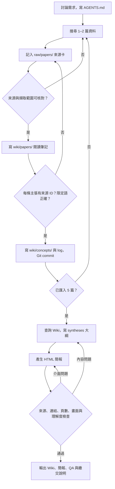

# 製作流程、一次執行紀錄與反思

## 1. 先討論，後生成

**教學主題**：聖誕節的意義、日期與常見習俗。  
**讀者**：原本不熟悉聖誕節的人。  
**先決定的問題**：聖誕節是什麼？12 月 25 日代表什麼？聖誕樹、聖誕老人與地方習俗如何形成？  
**範圍決策**：挑選五篇有機構署名的資料；每篇擷取一個核心教學問題。避免無法核對的傳說、唯一來源論及「所有地方都一樣」的概括。

工作規格記於 [`AGENTS.md`](AGENTS.md)，回答讀者、頁面類型、語言、細度、來源衝突、產出、lint 與停止條件。老師示範中的 Antigravity 不在本專案流程中；資料夾與 HTML 直接在此 Git 倉庫建立。

### 多檔案 Wiki 架構

```text
AGENTS.md              AI 工作規格
raw/papers/            5 篇來源卡（S1–S5）
wiki/index.md          Wiki 主題入口
wiki/schema.md         筆記 frontmatter 與 ID 規格
wiki/log.md            分批 ingest 紀錄
wiki/papers/           5 篇逐篇閱讀筆記
wiki/concepts/         5 個概念頁（W1–W5）
wiki/syntheses/        簡報大綱
wiki/tasks/            查詢、QA 規格與執行紀錄
```

`raw/` 保存來源與改寫擷取，不放個資或整篇受版權保護的文章；`wiki/` 才是整理後供簡報查詢的知識庫。[互動 Wiki 頁面](wiki.html) 是這個多檔案 Wiki 的展示版。[單檔摘要](wiki.md)僅供快速閱讀。

## 2. Loop / graph



### 哪些步驟會重複？

- **每 1–2 篇一輪 ingest**：搜尋 → `raw` → 逐篇筆記 → 概念頁 → log → commit；未滿五篇就再做下一輪。
- **來源／事實檢查**：來源或摘要若不能直接支援主張，回到來源卡或改寫閱讀筆記。
- **產生簡報 → QA**：若簡報主張超出 Wiki，回到統整稿；若是導覽、排版或連結問題，只修改 HTML。

### 為什麼這樣設計？

把事實檢查放在 `raw` → `wiki/papers` → `wiki/concepts` 的交界，可以先處理日期與習俗起源的含糊說法。簡報只使用已被整理和標記的 W1–W5，並由 [`slide-query.md`](wiki/tasks/slide-query.md) 記錄每頁的 Wiki 查詢結果。

## 3. 一次實際執行與檢查紀錄（2026-11-23）

| 階段 | 實際執行與檢查 | 結果／修正 |
|---|---|---|
| 討論 | 把主題限縮為節日定義、日期、聖誕樹、聖誕老人和兩種地方文化例子。 | 形成五個 Wiki 問題，適合 10 頁入門簡報。 |
| 搜尋／匯入 | 搜尋美國國會圖書館、國家公園管理局、史密森尼學會的資料；建立 S1–S5 五張來源卡。 | 分三批 ingest：`d51e46e`（S1–S2）、`c95291c`（S3–S4）、`f303b01`（S5）；每篇有獨立閱讀筆記與概念頁。 |
| 來源限制 | S1、S4 的網站對自動開啟回傳 403；可見的是館方搜尋索引摘要。 | 在來源卡與閱讀筆記明示取得方式，第三輪用利物浦大學與美國國會圖書館的可讀全文交叉查核相關主張。 |
| 事實檢查 | S1 說明西元 336 年已有 12 月 25 日的慶祝，但沒有證明耶穌確切生日。 | 在 W1 加入「慶祝日期不等於出生日期」，第 3 頁依此重寫。 |
| 事實檢查 | S3 說明 Father Christmas 與 Santa Claus 在 19 世紀逐漸融合。 | 在 W3 加入「多條傳統結合」，避免「某家公司發明聖誕老人」的單一起源論。 |
| 事實檢查 | S4 描述 Las Posadas，但不能代表所有拉丁美洲家庭。 | 在 W4 與第 6 頁都限定為「西班牙與許多拉丁美洲地區」。 |
| 簡報產生 | 由 W1–W5 查詢後形成 T1 簡報大綱與逐頁查詢紀錄；第 2–7 頁各對應概念，第 8–10 頁統整、測驗與列來源。 | 每個具體主張都能沿 Wiki 概念頁 → 閱讀筆記 → 來源卡回查。 |
| 技術檢查 | 檢查 HTML、內部連結、來源數量、各頁來源標記及互動操作。 | 詳細驗證結果見下方「驗證結果」。 |

## 4. 反思與 workflow 修正

**最常出錯的節點**：把來源資訊轉成 Wiki 教學句子的節點。這一輪發現三類容易寫得過度肯定的地方：12 月 25 日是否為確切生日、聖誕老人是否有單一起源、地方習俗是否能代表所有家庭。它們都發生在 `raw` → `wiki/papers` 的轉換時。

**檢查往前移到哪裡**：原型簡報完成後才逐頁核對；本次重構在 `raw` 來源卡、逐篇閱讀筆記與概念頁之間就檢查來源支援程度，加入「限定語／不採用內容」，通過後才進入簡報編排。

**有無修改 graph**：有。原型只有單檔摘要，本次拆成 `raw → papers → concepts → syntheses`；加入「每條事實有來源 ID？語氣是否過度肯定？」的閘門與 1–2 篇一輪的 ingest loop。若不通過，就返回來源卡或筆記修訂。這讓 W 編號可追到每篇來源，而不只追到單一 HTML 頁。

## 5. Wiki → 簡報對應

| Wiki 條目 | 簡報頁 | 教學主張 |
|---|---:|---|
| W1 節日與日期 | 2、3 | 紀念耶穌誕生；12 月 25 日是慶祝日期。 |
| W2 聖誕樹 | 4 | 現代熟悉的習俗在 19 世紀更普及。 |
| W3 聖誕老人 | 5 | 多條傳統於 19 世紀逐漸融合。 |
| W4 Las Posadas | 6 | 地方社群有不同慶祝方式。 |
| W5 聖誕紅 | 7 | 墨西哥植物與跨國傳播。 |
| W1–W5 統整 | 8–10 | 分類、檢核理解、回顧來源。 |

## 6. 驗證結果

重構後第一輪執行 `python validate.py` 發現 `wiki/tasks/qa-runs.md` 缺漏，造成兩個 Markdown 連結失效。補上實際 QA 紀錄後，第二輪得到：`PASS: 5 raw sources, 5 reading notes, 5 concept pages, traceable claims, Wiki architecture, 10 slides, local links and JavaScript syntax`。第三輪針對 S1、S4 的索引摘要限制加入可讀全文交叉查核，再次執行同一檢查仍通過。檢查涵蓋五張來源卡、五篇逐篇筆記、五個概念頁、事實 ID、Markdown 與 HTML 的相對連結、簡報第 2–7 頁的 Wiki／來源連結、十頁頁數、測驗正確答案數，以及內嵌 JavaScript 語法。逐輪輸出見 [`qa-runs.md`](wiki/tasks/qa-runs.md)。

另以 Chrome 無頭模式實際渲染，檢視了 [Wiki 桌面畫面](evidence/wiki-desktop.png)、[流程頁桌面畫面](evidence/process-desktop.png) 和 [簡報第 4 頁桌面畫面](evidence/slide4-desktop.png)。第 4 頁以網址 `slides.html#4` 開啟，畫面顯示 `04 / 10`、對應文字、聖誕樹插圖及前後頁按鈕，證實頁碼初始化與該頁版面正常。這些截圖不能代表所有螢幕大小和全部互動均已逐一手動操作；測驗程式已通過語法檢查，仍可在瀏覽器第 9 頁自行操作。
