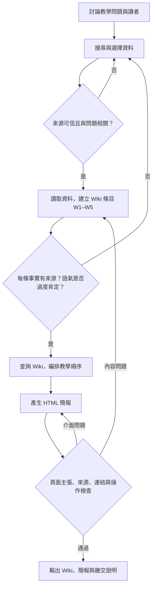

# 製作流程、一次執行紀錄與反思

## 1. 先討論，後生成

**教學主題**：聖誕節的意義、日期與常見習俗。  
**讀者**：原本不熟悉聖誕節的人。  
**先決定的問題**：聖誕節是什麼？12 月 25 日代表什麼？聖誕樹、聖誕老人與地方習俗如何形成？  
**範圍決策**：挑選五篇有機構署名的資料；每篇擷取一個核心教學問題。避免無法核對的傳說、唯一來源論及「所有地方都一樣」的概括。

## 2. Loop / graph

### 哪些步驟會重複？

- **搜尋 → 來源檢查**：資料若與初學者問題不符，就換搜尋詞與資料。
- **建立 Wiki → 事實檢查**：若事實的依據不夠直接，就改寫、更換來源或刪除。
- **產生簡報 → 檢查**：若簡報主張超出 Wiki，回到 Wiki；若是導覽、排版或連結問題，只修改 HTML。

### 為什麼這樣設計？

把事實檢查放在 Wiki 條目生成後、簡報生成前，可以先處理日期與習俗起源的含糊說法。簡報只使用已被整理和標記的 W1–W5，避免在畫面設計階段臨時加入沒有出處的知識。

## 3. 一次實際執行與檢查紀錄（2026-11-23）

| 階段 | 實際執行與檢查 | 結果／修正 |
|---|---|---|
| 討論 | 把主題限縮為節日定義、日期、聖誕樹、聖誕老人和兩種地方文化例子。 | 形成五個 Wiki 問題，適合 10 頁入門簡報。 |
| 搜尋／匯入 | 搜尋美國國會圖書館、國家公園管理局、史密森尼學會的資料；記錄 S1–S5 原始連結。 | 5 篇來源轉成 5 條目，保留來源和對應簡報頁碼。 |
| 事實檢查 | S1 說明西元 336 年已有 12 月 25 日的慶祝，但沒有證明耶穌確切生日。 | 在 W1 加入「慶祝日期不等於出生日期」，第 3 頁依此重寫。 |
| 事實檢查 | S3 說明 Father Christmas 與 Santa Claus 在 19 世紀逐漸融合。 | 在 W3 加入「多條傳統結合」，避免「某家公司發明聖誕老人」的單一起源論。 |
| 事實檢查 | S4 描述 Las Posadas，但不能代表所有拉丁美洲家庭。 | 在 W4 與第 6 頁都限定為「西班牙與許多拉丁美洲地區」。 |
| 簡報產生 | 以 W1–W5 依序編成第 2–7 頁，第 8 頁統整，第 9 頁測驗，第 10 頁列來源。 | 每個具體主張都能回查 Wiki 條目；設計桌面與手機版。 |
| 技術檢查 | 檢查 HTML、內部連結、來源數量、各頁來源標記及互動操作。 | 詳細驗證結果見下方「驗證結果」。 |

## 4. 反思與 workflow 修正

**最常出錯的節點**：把檢索內容整理成教學句子的節點。這一輪發現三類容易寫得過度肯定的地方：12 月 25 日是否為確切生日、聖誕老人是否有單一起源、地方習俗是否能代表所有家庭。它們都發生在「來源 → Wiki 條目」的轉換時。

**檢查往前移到哪裡**：原本可在簡報完成後才逐頁核對；本次改為在 Wiki 條目寫好後立即檢查來源支援程度，並在每條目加入「不要推論／避免誤說」，通過後才進入簡報編排。

**有無修改 graph**：有。加入「每條事實有來源？語氣是否過度肯定？」的閘門；若不通過，就返回搜尋或條目修訂。這能降低最後一刻大量重做簡報的機會，也讓讀者從 W 編號追查每頁內容。

## 5. Wiki → 簡報對應

| Wiki 條目 | 簡報頁 | 教學主張 |
|---|---:|---|
| W1 節日與日期 | 2、3 | 紀念耶穌誕生；12 月 25 日是慶祝日期。 |
| W2 聖誕樹 | 4 | 現代熟悉的習俗在 19 世紀更普及。 |
| W3 聖誕老人 | 5 | 多條傳統於 19 世紀逐漸融合。 |
| W4 Las Posadas | 6 | 地方社群有不同慶祝方式。 |
| W5 聖誕紅 | 7 | 墨西哥植物與跨國傳播。 |
| W1–W5 統整 | 8–10 | 分類、檢核理解、回顧來源。 |

## 6. 驗證結果

在專案目錄執行 `python validate.py`，結果為：`PASS: 4 HTML pages, 5 Wiki source records, 10 slides, local links and inline JavaScript syntax`。這項檢查確認四個 HTML 頁面存在、Wiki 有五條資料紀錄、簡報有十頁、相對連結指向存在的檔案，且內嵌 JavaScript 可通過 Node.js 語法檢查。

另以 Chrome 無頭模式實際渲染，檢視了 [Wiki 桌面畫面](evidence/wiki-desktop.png) 和 [簡報第 4 頁桌面畫面](evidence/slide4-desktop.png)。第 4 頁以網址 `slides.html#4` 開啟，畫面顯示 `04 / 10`、對應文字、聖誕樹插圖及前後頁按鈕，證實頁碼初始化與該頁版面正常。這些截圖不能代表所有螢幕大小和全部互動均已逐一手動操作；測驗程式已通過語法檢查，仍可在瀏覽器第 9 頁自行操作。
